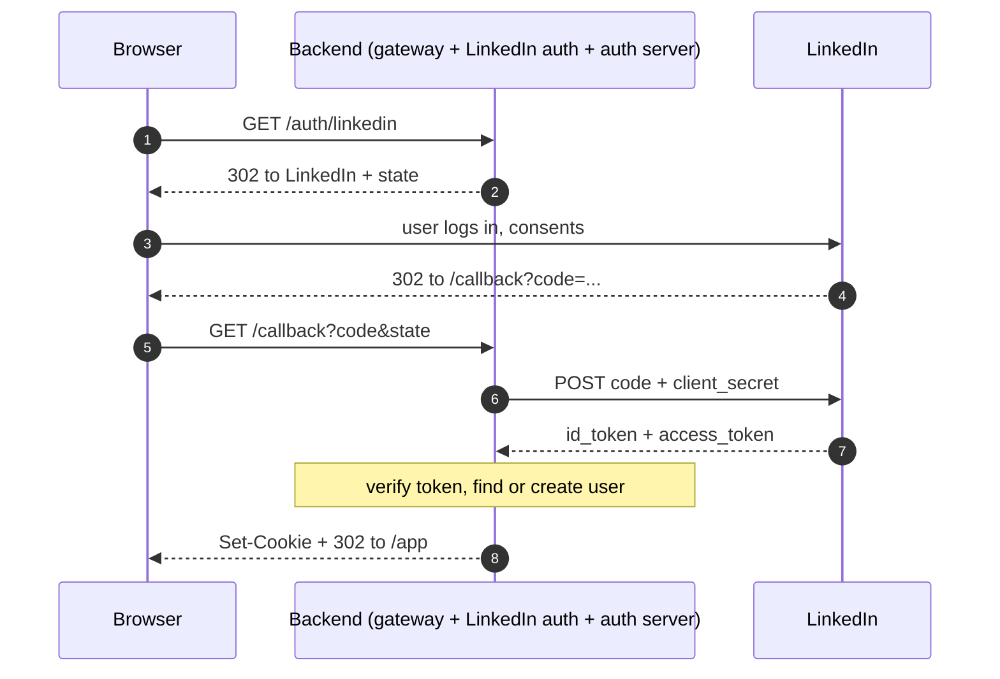

# LinkedIn Login Flow

Part of [[overview]]. Implemented by [[linkedin-auth-server]] (LinkedIn side) and [[auth-server]] (user and session side). The original diagram is `Linked_auth_activity_diagram.svg` in this folder.

LinkedIn is the **only** way to sign in or create an account. If it is the user's first time, the account is created for them.

## Sequence

Browser steps are **redirects**. Steps 6 and 7 are **server to server** and carry the secret, so the secret never reaches the browser.

## What each step must guarantee

| Step | Check |
|---|---|
| 2 | Generate an unguessable `state`, bind it to this browser (short-lived cookie or server store) |
| 5 | Compare returned `state` with the stored one, otherwise reject (CSRF protection) |
| 6 | Send `client_secret` only server to server, over HTTPS |
| 7-8 | Verify the `id_token`: signature (LinkedIn JWKS), `iss`, `aud` = our client ID, `exp`, `nonce` |
| 8 | Find the user by LinkedIn `sub`; create if missing; load roles |
| 9 | Session cookie: `HttpOnly`, `Secure`, `SameSite=Lax`; then redirect into the app |

> [!important]
> The redirect URL registered in LinkedIn must match the callback **exactly**, and it must be the public edge URL, not `localhost` (see [[linkedin-app-setup]]).

## Questions to think through

- Why does the flow use a redirect carrying a short-lived `code` instead of returning the token directly in the browser's URL?
- What attack does `state` stop? What would an attacker do if it were missing?

## Links
- LinkedIn OIDC sign-in: https://learn.microsoft.com/en-us/linkedin/consumer/integrations/self-serve/sign-in-with-linkedin-v2
- LinkedIn authorization code flow: https://learn.microsoft.com/en-us/linkedin/shared/authentication/authorization-code-flow
- OAuth 2.0 (RFC 6749): https://datatracker.ietf.org/doc/html/rfc6749
- OIDC Core spec: https://openid.net/specs/openid-connect-core-1_0.html
