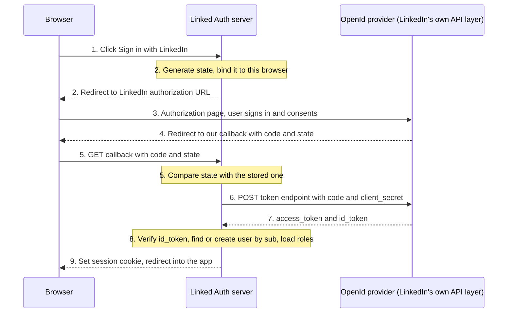

# LinkedIn Login Flow

LinkedIn is the **only** way to sign in. If it is the user's first time, the account is created for them (just-in-time provisioning).

The flow is the **OpenID Connect Authorization Code Flow**: OAuth 2.0 answers *what may this app access*, and OIDC adds *who is this user* through the `id_token`.

## Sequence

Steps 1-5 and 9 pass through the **browser** (requests and redirects). Step 6 (the request, which carries the secret) and step 7 (the response, which carries the tokens) are **server to server**, so neither the secret nor the tokens reach the browser.

## What each step must guarantee

| Step | Check |
|---|---|
| 2 | Generate an unguessable `state` and bind it to **this browser**: keep the server-side record under a random id, and put that id in a short-lived cookie (`HttpOnly`, `Secure`, `SameSite=Lax`). A server store alone is not enough, because nothing ties it to the browser that started the login. Request `scope=openid profile email` |
| 5 | If the callback carries `error` (`user_cancelled_login`, `user_cancelled_authorize`), stop there. Otherwise compare the returned `state` with the stored one, **use it once** (delete it after reading), and reject on a mismatch, a missing value or an expired entry (CSRF protection) |
| 6 | Send `client_id` and `client_secret` in the **POST body** (form-encoded), only server to server, over HTTPS. Never in a URL. The code is single-use and short-lived, so exchange it immediately |
| 7-8 | Verify the `id_token`: signature (LinkedIn JWKS, `RS256`), `iss` = `https://www.linkedin.com`, `aud` = our client ID, `exp` and `iat` |
| 8 | Find the user by LinkedIn `sub`; create if missing; load roles. Do **not** use the email as the key, because it is optional and can be absent |
| 9 | Issue a **new** session id (never reuse one from before login). Cookie: `HttpOnly`, `Secure`, `SameSite=Lax`. Then redirect into the app |

> [!important]
> **Redirect URL.** LinkedIn requires an absolute `HTTPS` URL with no `#`, registered in the developer portal, and the `redirect_uri` we send must match a registered one. Query parameters are ignored. Our own decision is to register the public edge URL and not `localhost` (see [[linkedin-app-setup]]).

> [!info]
> **Why `SameSite=Lax` and not `Strict`.** Step 4 is a cross-site redirect from LinkedIn back to us. A `Strict` cookie is not sent on that navigation, so the `state` cookie would be missing exactly when step 5 needs it.

## LinkedIn specifics

| Item | Value |
|---|---|
| Discovery document | `https://www.linkedin.com/oauth/.well-known/openid-configuration` |
| Authorization endpoint | `https://www.linkedin.com/oauth/v2/authorization` |
| Token endpoint | `https://www.linkedin.com/oauth/v2/accessToken` |
| JWKS | `https://www.linkedin.com/oauth/openid/jwks` |
| UserInfo endpoint | `https://api.linkedin.com/v2/userinfo` |
| `iss` | `https://www.linkedin.com` |
| Signing algorithm | `RS256` |
| Scopes | `openid` (required for the `id_token`), `profile`, `email` |
| Requires | The *Sign In with LinkedIn using OpenID Connect* product enabled on the app |
| `sub` | Pairwise: stable for **our app**, not a global LinkedIn member id |
| `email`, `email_verified` | **Optional**; the app must work without them |

The `id_token` already carries the profile claims, so for login alone a separate UserInfo call is not required. Since this app only needs *identity*, there is no reason to keep the LinkedIn access token after step 8.

> Open items to verify against the real LinkedIn responses
> - **`nonce`.** The earlier version of this note listed a `nonce` check at step 8 but never generated one at step 2. LinkedIn's documentation does not list `nonce` among the authorization parameters or the `id_token` claims. Test whether LinkedIn echoes it. Until confirmed, do not make the login fail on a missing `nonce`, and rely on `state` for the browser binding.
> - **PKCE.** Not documented for this flow. We are a confidential server-side client with a `client_secret`, so it is not required, but check before relying on it.
> - **`localhost` redirects.** The LinkedIn docs say `HTTPS` but do not explicitly forbid `localhost`. The "public edge URL" rule above is our own decision, not a LinkedIn rule.
