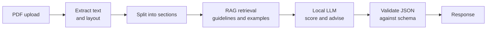

# AI Server

Part of [[architecture]]. Folder: `Backend/ai server`. Stack: **FastAPI** + a **local LLM** + **RAG**.

## Purpose

Receives a **LinkedIn profile PDF** and returns:

1. **Scores** for each metric the profile was analyzed on (0–100, where 100 is the top). Example: "you got 70 on skills, 80 on description, 78 on education".
2. **Nested JSON notes** for the user, with advice grouped by section and sub-topic.

It is private: only the [[gateway]] calls it.

## Metrics

`headline`, `about`, `experience`, `skills`, `education`, `network`, `activity`

## Response shape (inferred from the UI, to confirm)

```json
{
  "AnalysisResult": {_},
  "Graph":{_},
}
```

"_" means any type.

`notes` is **free-form and nested to any depth**, so the [[frontend]] needs a recursive renderer, and the API needs a stable contract (see below).

## Pipeline



## Design points

- **Validate the output.** LLMs return malformed JSON sometimes. Use Pydantic models for the response and retry or repair on failure.
- **Keep scores reproducible.** Fix temperature and prompts, and consider rubric-based scoring so the same profile gets similar scores.
- **Privacy.** Profile PDFs contain personal data. A local LLM keeps it on your machine; decide on retention (delete the PDF after analysis?).
- **Limits.** Enforce the 15 MB cap, check the file is a real PDF, and set a timeout. LLM calls are slow.

> [!question] Think about the data source
> A LinkedIn PDF export usually contains headline, about, experience, skills and education. Does it contain enough to judge **Network** and **Activity**? If not, where do those two scores come from (user input, an extra upload, a different source)? This decides whether those scores are trustworthy.

## Links
- FastAPI file uploads: https://fastapi.tiangolo.com/tutorial/request-files/
- Pydantic models: https://docs.pydantic.dev/latest/concepts/models/
- RAG overview: https://www.ibm.com/think/topics/retrieval-augmented-generation
