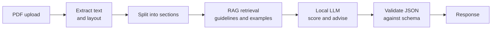

## Purpose

Receives a **LinkedIn profile PDF** and returns:

1. **Scores** for each metric the profile was analyzed on (0–100, where 100 is the top). Example: "you got 70 on skills, 80 on description, 78 on education".
2. **Nested JSON notes** for the user, with advice grouped by section and sub-topic.

## Metrics

Metrics are specified by the AI service team because they are the ones responsible for this answer: " what are the things that should be followed in order to get a good LinkedIn Profile ? "

## Output boundary

The AI service produces nested feedback and score data for the gateway. The
browser-facing `POST /api/analyze` response envelope and graph schema are
defined centrally in [[overview]]. Keep this page focused on the AI pipeline
and internal processing rather than duplicating the frontend API contract.

## Pipeline

## Design points

- **Validate the output.** LLMs return malformed JSON sometimes. Use Pydantic models for the response and retry or repair on failure.
- **Keep scores reproducible.** Fix temperature and prompts, and consider rubric-based scoring so the same profile gets similar scores.
- **Privacy.** Profile PDFs contain personal data. A local LLM keeps it on your machine; decide on retention (delete the PDF after analysis?).
- **Limits.** Enforce the 15 MB cap, check the file is a real PDF, and set a timeout. LLM calls are slow.

