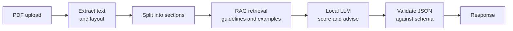

## Purpose

Receives a **LinkedIn profile PDF** and returns:

1. **Scores** for each metric the profile was analyzed on (0–100, where 100 is the top). Example: "you got 70 on skills, 80 on description, 78 on education".
2. **Plain-text feedback** for the user, with advice grouped by profile section.


## Metrics

Metrics are specified by the AI service team because they are the ones responsible for this answer: " what are the things that should be followed in order to get a good LinkedIn Profile ? "


## Output boundary

The AI service provides feedback text and structured score fields to the
gateway. The gateway stores the score record and returns only plain-text
feedback to the browser from `POST /api/analyze`; score history is retrieved
separately through `GET /api/analyses`. The browser-facing contract is in
[[overview]].

After a successful analysis, the gateway associates the result with the
authenticated user's `user_id` and stores the text and scores as an `Analysis`
record through the private [[database-server]]. The AI server does not write
directly to the database. The internal AI response must include the eight
scores defined in [[database-server]] alongside the feedback text.

The gateway expects an internal JSON object shaped like:

```json
{
  "analysis_result": "Plain-text profile feedback.",
  "completeness": 82,
  "content_quality": 68,
  "keyword_and_role_relevance": 75,
  "career_trajectory": 70,
  "skills_depth": 80,
  "social_proof": 64,
  "network": 55,
  "activity": 72
}
```

This internal response is not returned to the browser; the gateway stores the
scores and returns only `analysis_result` as `text/plain`.

## Pipeline



## Design points

- **Validate the output.** LLMs return malformed JSON sometimes. Use Pydantic models for the response and retry or repair on failure.
- **Keep scores reproducible.** Fix temperature and prompts, and consider rubric-based scoring so the same profile gets similar scores.
- **Privacy.** Profile PDFs contain personal data. A local LLM keeps it on your machine; decide on retention (delete the PDF after analysis?).
- **Limits.** Enforce the 15 MB cap, check the file is a real PDF, and set a timeout. LLM calls are slow.

