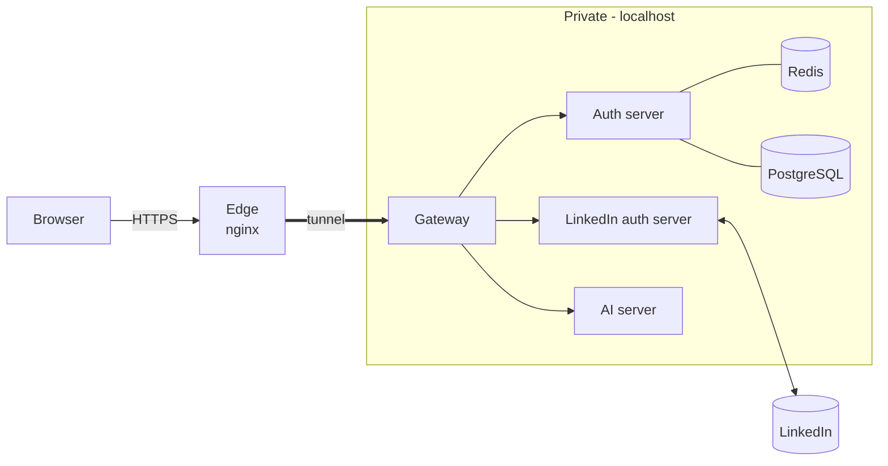

# Architecture

Part of [[overview]].

## Why this shape

The services run on a **local machine**, which has no public address and cannot receive connections from the internet. So we split the system into:

1. A **public edge** ([[edge-server]], nginx) that the internet can reach.
2. A **tunnel** from the local machine to the edge, opened *outbound* from the local side.
3. A **private network** of services behind a single door, the [[gateway]].

![[image.png]]

> [!note]
> `image.png` in this folder is the original structure image. The diagram above is the text version. See also `Diagram.drawio` at the repo root.

## Trust boundaries

| Zone | Contains | Reachable from internet? |
|---|---|---|
| Public | Edge server (nginx, TLS) | Yes |
| Private | Gateway, auth, LinkedIn auth, AI, databases | No, only through the tunnel and gateway |
| External | LinkedIn | Called by the LinkedIn auth server |

Rules that follow from this:
- Only the gateway is exposed through the tunnel. Other services bind to `127.0.0.1`.
- TLS terminates at the edge. Express runs with `trust proxy` set to the exact number of hops.
- The AI server never faces the internet. It only answers the gateway.

## Request paths

**Sign in:** Browser → Edge → Gateway → LinkedIn auth server → LinkedIn, then back, then [[auth-server]] creates the session. Full steps in [[auth-flow]].

**Analyze a PDF:** Browser → Edge → Gateway → (session check via [[auth-server]]) → [[ai-server]] → scores and notes back to the browser.

**Cache-aside (auth lookups)**, per `Diagram.drawio`:
1. Auth looks up the key in Redis.
2. Hit: return it. Miss: query PostgreSQL.
3. Fill Redis, return the result.

## Questions to think through

- Who verifies the session on each request: the gateway (by calling the auth server) or the gateway alone (by checking a signed token)? What does each choice cost in latency and in security?
- If the tunnel drops, what should users see? A branded maintenance page from the edge is nicer than a raw 502 (see [[known-issues]]).
- Where is the score history (previous vs current) stored? See [[auth-server]].

## Links
- API Gateway pattern: https://microservices.io/patterns/apigateway.html
- Cache-aside pattern: https://learn.microsoft.com/en-us/azure/architecture/patterns/cache-aside
- Express behind proxies: https://expressjs.com/en/guide/behind-proxies.html
