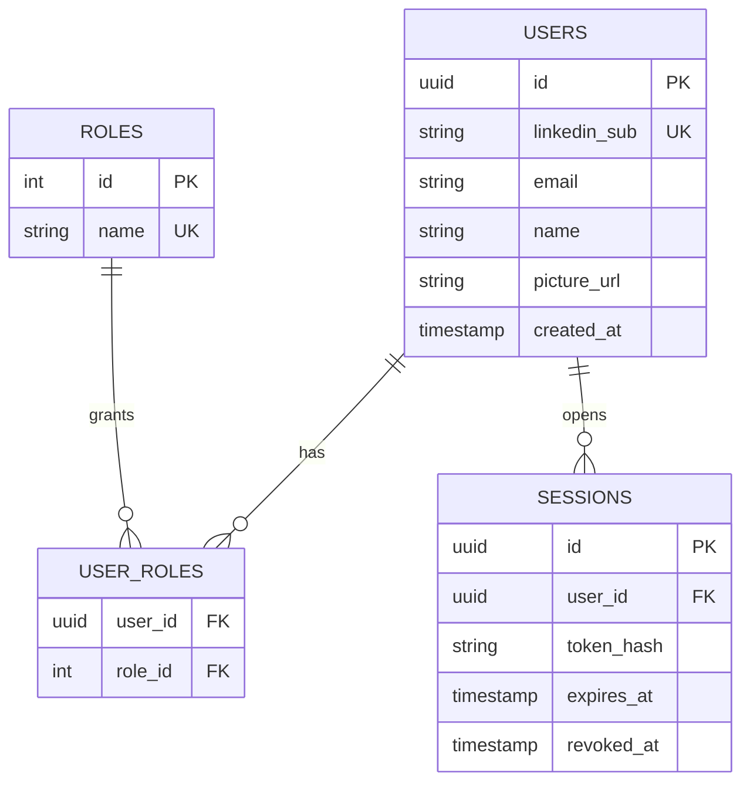

# Auth Server

Part of [[architecture]]. Folder: `Backend/auth server`. Stack: Express + PostgreSQL (Redis cache per `Diagram.drawio`).

## Purpose

Owns **who the user is and what they may do**:

- Manages **user session tokens**.
- Manages **roles and authorities**.
- **Saves the LinkedIn OpenID data** received from [[linkedin-auth-server]].
- Owns the **PostgreSQL** database.

## Responsibilities

| Area | Detail |
|---|---|
| Find or create user | Key on LinkedIn `sub`; store name, email, picture |
| Sessions | Issue, validate, rotate and revoke session tokens |
| Roles / authorities | e.g. `USER`, `ADMIN`; checked by the [[gateway]] |
| Caching | Redis cache-aside for hot lookups (session, roles) |

## Draft data model (proposal)

> [!note]
> Store only a **hash** of session tokens, never the raw token.

## Open decisions

> [!question] Where does score history live?
> The dashboard shows **current vs previous** scores and "+7 since your last check". Something must persist each analysis per user. Options: an `analyses` table here, or a separate store owned by the [[ai-server]] side. Decide who owns it.

> [!question] Session style
> Cookie with a server-side session, or a short-lived JWT plus refresh token? The login flow sets a cookie ([[auth-flow]], step 9). Which one the gateway checks per request affects latency and revocation.

## Links
- OWASP session management: https://cheatsheetseries.owasp.org/cheatsheets/Session_Management_Cheat_Sheet.html
- PostgreSQL docs: https://www.postgresql.org/docs/
- Redis caching patterns: https://redis.io/solutions/caching/
