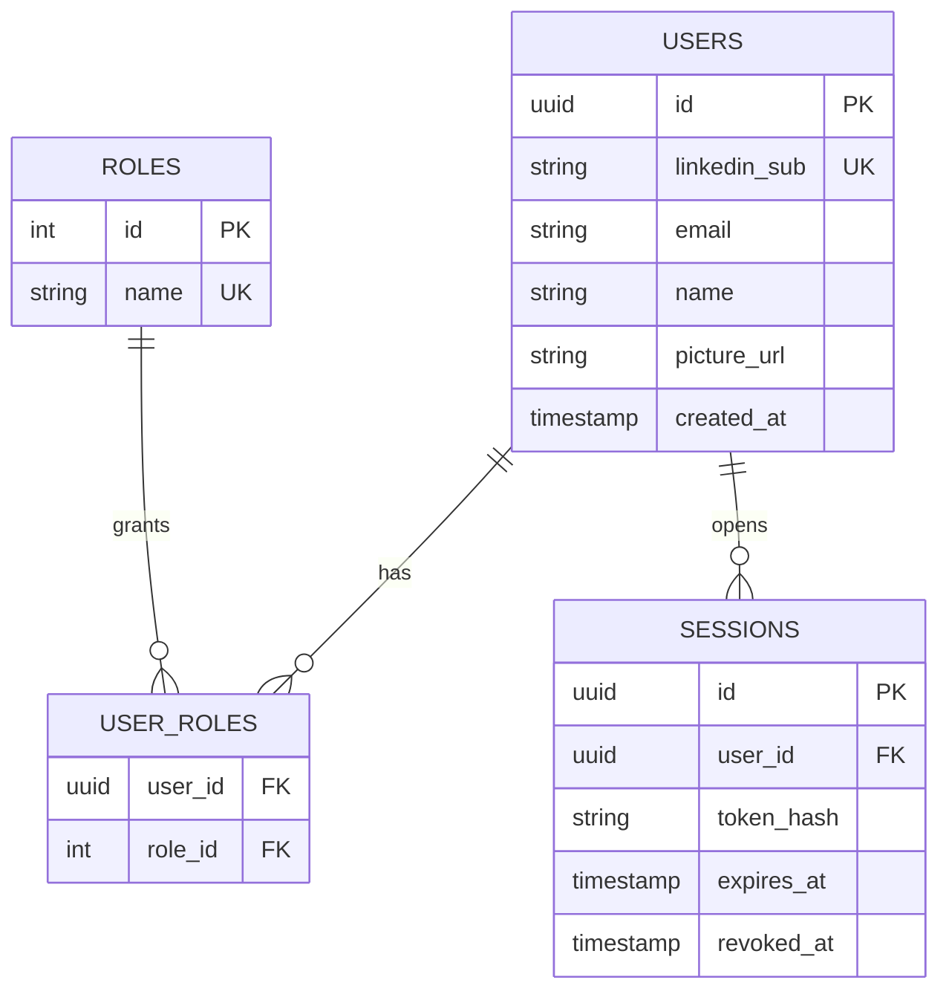

## Purpose
The auth server is the server responsible for securing the application by enforcing authorization on every layer of the application we have only 3 layers of authorization:  
- **Guest** : guests can only reach linkedIn sign page and the application's home page. 
- 

## Responsibilities

| Area | Detail |
|---|---|
| Find or create user | Key on LinkedIn `sub`; store name, email, picture |
| Sessions | Issue, validate, rotate and revoke session tokens |
| Roles / authorities | e.g. `USER`, `ADMIN`; checked by the [[gateway]] |
| Caching | Redis cache-aside for hot lookups (session, roles) |

## Draft data model (proposal)

> [!note]
> Store only a **hash** of session tokens, never the raw token.

## Frontend API boundary

The auth server's internal user and session operations are described above. The
public frontend-to-gateway endpoints and their request/response contracts are
defined centrally in [[overview]]; this service document does not define a
separate browser-facing API.
- 