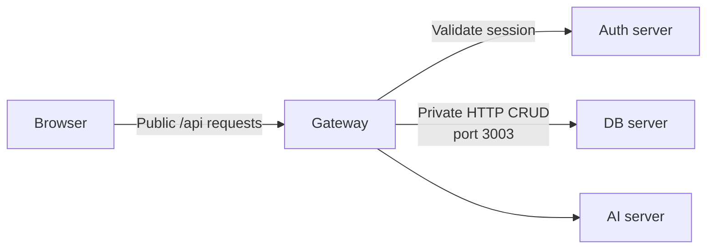

# Database Server

Part of [[overview]]. This document defines the planned internal HTTP API for
persisting `User` and `Analysis` records.

> [!warning] Planned service
> The DB server is not implemented in this repository. It will run as a
> separate service with its own port (`3003` in the gateway configuration).
> The storage engine is undecided. The routes below are the proposed contract,
> not live endpoints.

## Boundary and request flow



- The gateway calls the DB server directly; user and analysis CRUD do not go
  through the auth server.
- The gateway validates protected browser requests with the auth server's
  private `/authorize` endpoint before reading or mutating user data.
- The DB server is internal-only. Do not expose its port through the edge
  server, Vite proxy, or browser.
- The gateway's configured DB service URL is `http://localhost:3003`; see
  `Backend/gateway/config/config.json`.
- Configure `DB_SERVICE_TOKEN` in the gateway environment and the matching
  credential in the DB service before enabling internal calls. The auth server
  also uses this credential for its private credential lookup and account
  creation requests.
-   Service authentication is required for gateway and auth-server DB requests.
  Actor identity headers below are authorization context and are not, by
  themselves, proof that the caller is the gateway.

## Entities

The source for the initial entity fields is [`Bd.drawio`](Bd.drawio).

### `User`

| Field | Meaning |
|---|---|
| `id` | Primary key; concrete type/format TBD |
| `name` | Display name |
| `given_name` | Given name |
| `family_name` | Family name |
| `email` | Email address |
| `email_verified` | Whether the email was verified by LinkedIn |
| `password_hash` | App-password hash; never return it from general user CRUD |
| `credential_version` | Monotonically increasing version; increment when authentication credentials change |
| `role` | Authorization role, currently described as `USER` or `ADMIN` |

### `Analysis`

| Field | Meaning |
|---|---|
| `id` | Primary key; concrete type/format TBD |
| `user_id` | Foreign key to `User.id`; one user can have many analyses |
| `analysis_result` | Plain-text AI feedback |
| `created_at` | Server-generated timestamp used to order analysis history |
| `completeness` | Score from 0 to 100 |
| `content_quality` | Score from 0 to 100 |
| `keyword_and_role_relevance` | Score from 0 to 100 |
| `career_trajectory` | Score from 0 to 100 |
| `skills_depth` | Score from 0 to 100 |
| `social_proof` | Score from 0 to 100 |
| `network` | Score from 0 to 100 |
| `activity` | Score from 0 to 100 |

The database diagram does not yet include `linkedin_sub`, although one-time
LinkedIn sign-up uses that stable identity claim to associate the account.
Add it as a unique user field. The verified email must also be unique because
it is the later sign-in identifier. A server-generated `updated_at` is
recommended for mutable records.

## Internal HTTP contract

All paths below are **proposed**. They are private DB-server paths, not
frontend routes. The gateway supplies these headers from the authenticated
identity returned by the auth server's private `/authorize` route:

```http
X-Actor-Id: <authenticated-user-id>
X-Actor-Role: USER
```

The gateway must overwrite these values; never copy them from browser input.
The DB server independently validates that the actor exists, that the role is
valid, that the requested operation is allowed, and that fields are valid.
Missing or invalid actor context is rejected. Requests also require trusted
gateway-to-DB service authentication.

The required security rules are that normal user creation never assigns
`ADMIN`, self-update cannot grant `ADMIN`, and every `PATCH` carries the
authenticated actor's ID and role. Owner/admin read and delete permissions
below are proposed defaults to confirm before implementation.

### User CRUD

#### `POST /internal/v1/users`

**Request**

General user creation is restricted to trusted services. LinkedIn-based
account registration uses the separate auth-only endpoint below so the DB
server can also initialize passwords for existing LinkedIn accounts.

```json
{
  "user": {
    "linkedin_sub": "linkedin-subject",
    "name": "Ada Lovelace",
    "given_name": "Ada",
    "family_name": "Lovelace",
    "email": "ada@example.com"
  }
}
```

**Response**

`201 Created` with the stored user, including its generated `id` and `role`.
An existing `linkedin_sub` returns `409 Conflict`; it must not create a
duplicate account. This route is not used for the LinkedIn password setup
flow.

#### `POST /internal/v1/auth/signup`

**Request**

Auth-server-only registration after LinkedIn identity verification. The
password is already hashed with `scrypt`; the DB server must never receive
plaintext credentials.

```json
{
  "identity": {
    "linkedin_sub": "linkedin-subject",
    "email": "ada@example.com",
    "email_verified": true,
    "name": "Ada Lovelace",
    "given_name": "Ada",
    "family_name": "Lovelace"
  },
  "password_hash": "scrypt$<salt-hex>$<derived-key-hex>"
}
```

Create a new `USER` record if the LinkedIn subject is new. If that subject
already has a local user record but no app password, attach the verified email
and password hash to that record and increment `credential_version`. This
allows existing LinkedIn-only users to complete the one-time setup. If that
account already has a password, or the email is already owned by a different
user, return `409 Conflict`.

**Response**

`201 Created` for a new account or `200 OK` when initializing an existing
LinkedIn-only account. Return the auth record required by the auth server:
`id`, `email`, `password_hash`, `credential_version`, `display_name`, and
`role`.

#### `GET /internal/v1/auth/users/by-email/{email}`

**Request**

Auth-server-only credential lookup by normalized, verified email. Requires
`DB_SERVICE_TOKEN`; no actor headers are accepted in place of service
authentication.

**Response**

`200 OK` with the private auth record:

```json
{
  "id": "user-123",
  "email": "ada@example.com",
  "password_hash": "scrypt$<salt-hex>$<derived-key-hex>",
  "credential_version": 1,
  "display_name": "Ada Lovelace",
  "role": "USER"
}
```

Return `404 Not Found` for an unknown email. This endpoint must not be exposed
to the browser or included in general user-list responses.

#### `GET /internal/v1/auth/users/{userId}`

**Request**

Auth-server-only lookup for 24-hour session revalidation. Requires
`DB_SERVICE_TOKEN`.

**Response**

`200 OK` with the same private auth record as the email lookup, or `404 Not
Found` when the account no longer exists. Increment `credential_version`
whenever the password or another authentication credential changes.

#### `GET /internal/v1/users`

**Request**

No body. Requires an authenticated `ADMIN` actor.

**Response**

`200 OK` with the user collection. Non-admin actors receive `403 Forbidden`.

#### `GET /internal/v1/users/{userId}`

**Request**

No body. Requires actor headers. A `USER` may read only their own record;
`ADMIN` may read any record.

**Response**

`200 OK` with the user object, or `404 Not Found` when no record exists.

#### `GET /internal/v1/users/by-linkedin-sub/{linkedinSub}`

**Request**

No body. Gateway-only lookup after the LinkedIn auth server has verified the
identity. The subject must come from the verified LinkedIn response, never
from an untrusted browser field.

**Response**

`200 OK` with the matching user, or `404 Not Found` when the account has not
been created yet. The gateway may then create it with `POST /internal/v1/users`.

#### `PATCH /internal/v1/users/{userId}`

**Request**

Requires both `X-Actor-Id` and `X-Actor-Role`. The gateway derives them from
`/api/me`. The JSON body contains only fields to change:

```json
{
  "name": "Ada Byron"
}
```

The target ID and actor ID/role are separate: the DB server checks both before
applying the patch. A `USER` may update only their own permitted profile
fields. A role change requires an `ADMIN` actor targeting a different user;
even an admin cannot change their own role through this route. The `id` and
`linkedin_sub` fields are immutable.

**Response**

`200 OK` with the updated user. Invalid fields return `400 Bad Request`;
unauthorized changes return `403 Forbidden`; missing users return
`404 Not Found`.

#### `DELETE /internal/v1/users/{userId}`

**Request**

No body. Requires an authenticated `ADMIN` actor. The DB server must apply its
documented foreign-key/deletion policy for linked analyses; that policy must
be settled before enabling this route.

**Response**

`204 No Content` when deleted, or `404 Not Found` when no user exists.

### Analysis CRUD

All analysis reads and mutations are scoped to the authenticated user. The
gateway obtains the actor headers from the auth server's private `/authorize`
response; the DB server derives the record's `user_id` from that identity for
creation and does not permit an ordinary user to transfer an analysis to
another user.

#### `POST /internal/v1/analyses`

**Request**

Requires actor headers. The gateway sends the validated AI result and metric
scores; it does not choose the owner independently of the authenticated actor.

```json
{
  "analysis": {
    "analysis_result": "A concise profile assessment with recommendations.",
    "completeness": 82,
    "content_quality": 68,
    "keyword_and_role_relevance": 75,
    "career_trajectory": 70,
    "skills_depth": 80,
    "social_proof": 64,
    "network": 55,
    "activity": 72
  }
}
```

**Response**

`201 Created` with the stored analysis, including generated `id`, the
authenticated `user_id`, and server-generated timestamps once they are added
to the schema. Every supplied score must be finite and between 0 and 100.
The internal AI-to-gateway response must provide this text and the eight
structured scores; the gateway stores the record before returning only the
plain-text feedback from `POST /api/analyze` to the browser.

#### `GET /internal/v1/analyses?limit={count}`

**Request**

No body. Requires actor headers. `limit` is an integer from 1 to 10 and
defaults to 10. A `USER` receives only their own analyses; an `ADMIN` may
request another user's records with `?user_id={userId}`.

**Response**

`200 OK` with up to `limit` analysis records. Results are ordered newest first
by server-generated `created_at`. The latest record is included in the
response; aggregation of older records is a frontend concern, not a stored
`oldval` field.

#### `GET /internal/v1/analyses/{analysisId}`

**Request**

No body. Requires actor headers. A `USER` may read only an analysis whose
`user_id` matches `X-Actor-Id`; an `ADMIN` may read any analysis.

**Response**

`200 OK` with the analysis object, or `404 Not Found` when it does not exist.

#### `PATCH /internal/v1/analyses/{analysisId}`

**Request**

Requires `X-Actor-Id` and `X-Actor-Role`. The body contains only fields to
change. The DB server verifies ownership/role and validates all updated
scores. `id` and `user_id` are immutable through this endpoint.

```json
{
  "analysis": {
    "content_quality": 74
  }
}
```

**Response**

`200 OK` with the updated analysis. Invalid fields/scores return
`400 Bad Request`, unauthorized changes return `403 Forbidden`, and missing
records return `404 Not Found`.

#### `DELETE /internal/v1/analyses/{analysisId}`

**Request**

No body. Requires actor headers. A user may delete only their own analysis;
an admin may delete any analysis.

**Response**

`204 No Content` when deleted, or `404 Not Found` when no record exists.

## Method and authorization rules

- Use `POST` to create, `GET` to read, `PATCH` for partial updates, and
  `DELETE` to delete. There are no `PUT` routes.
- The DB server validates and enforces every mutation even after the gateway
  checks `/api/me`; gateway checks are not a replacement for DB authorization.
- A `POST /users` request cannot create an `ADMIN`. A `USER` cannot change
  their own role to `ADMIN` with `PATCH`; any role change requires an `ADMIN`
  actor and a different target user.
- For every `PATCH`, the gateway passes the authenticated actor's ID and role.
  The DB server checks the role, target ID, ownership, and changed fields.
- Reject malformed payloads with `400`, missing/invalid authentication context
  with `401`, forbidden operations with `403`, missing records with `404`, and
  uniqueness conflicts with `409`. Return safe error bodies without secrets
  or stack traces.

## Open implementation decisions

- Choose the storage engine and implement the service on configured port 3003.
- Add `linkedin_sub` to the user entity/schema.
- Define and validate the internal AI-to-gateway shape for text feedback plus
  the eight score fields.
- Confirm collection-read and delete permissions for users and analyses.
- Decide the user-delete policy for dependent analyses and how the first
  `ADMIN` is provisioned.
- Implement service-to-service authentication, validation, migrations, and
  these internal routes before treating this contract as live.
