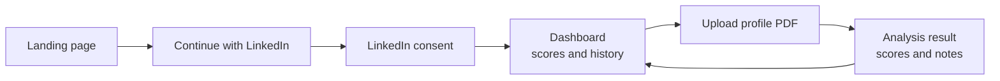
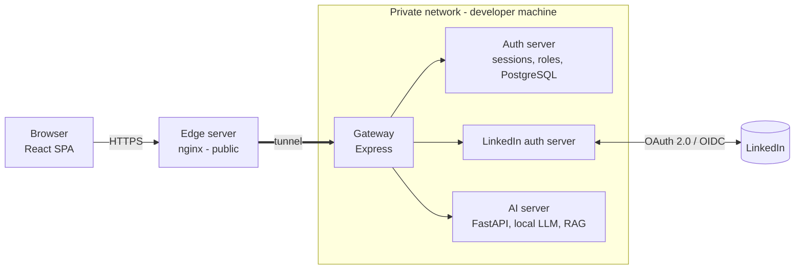

# Profile Rater — Overview

One-line summary

> Profile Rater is a web app where a user signs in with **LinkedIn**, uploads their **LinkedIn profile as a PDF**, and receives a **score out of 100 per profile section** plus **actionable notes**, while tracking progress against their previous check.

## What the user gets

- **Sign in / sign up with LinkedIn only.** The account is created automatically on first login.
- **Upload a profile PDF** (max 15 MB) and get an analysis.
- **Seven section scores** (0–100): Headline, About, Experience, Skills, Education, Network, Activity.
- **An overall score** with the change since the last check (example: 69, up 7 from 62).
- **"Work on these first"**: the lowest-scoring sections.
- **Detailed notes** as nested feedback, for example under Skills → Programming → React: _"it is better to specify experience"_.

## The user journey



## System at a glance



Details: [architecture](architecture.md).

## Components

| Component            | Folder                         | Role                                                                             | Doc                                             |
| -------------------- | ------------------------------ | -------------------------------------------------------------------------------- | ----------------------------------------------- |
| Frontend             | `frontend/`                    | React SPA: login, dashboard, upload                                              | [Frontend](frontend.md)                         |
| Edge server          | `Backend/edge server`          | Public nginx that exposes the local app to the internet                          | [Edge server](edge-server.md)                   |
| Gateway              | `Backend/gateway`              | Single entry point; orchestrates the private servers                             | [Gateway](gateway.md)                           |
| Auth server          | `Backend/auth server`          | Sessions/tokens, roles and authorities, stores LinkedIn OpenID data (PostgreSQL) | [Auth server](auth-server.md)                   |
| LinkedIn auth server | `Backend/LinkedIn-auth-server` | Sign-in/up flow with LinkedIn, state verification and validation                 | [LinkedIn auth server](linkedin-auth-server.md) |
| AI server            | `Backend/ai server`            | FastAPI + local LLM + RAG; PDF in, scores and notes out                          | [AI server](ai-server.md)                       |

## Tech stack

| Layer                        | Technology                                         |
| ---------------------------- | -------------------------------------------------- |
| Frontend                     | React, TypeScript, Vite, ESLint                    |
| Gateway, Auth, LinkedIn auth | Node.js, Express                                   |
| AI                           | Python, FastAPI, local LLM, RAG                    |
| Data                         | PostgreSQL (and Redis cache, per `Diagram.drawio`) |
| Edge                         | nginx plus a tunnel to localhost                   |
| Identity                     | LinkedIn, Sign In with OpenID Connect              |

## Repository layout

```
.
├── Backend/
│   ├── ai server/
│   ├── auth server/
│   ├── edge server/
│   ├── gateway/
│   └── LinkedIn-auth-server/
├── docs/                 <- you are here
├── frontend/             <- Vite + React + TypeScript
├── Diagram.drawio
├── plan.md
└── Readme.md
```

## Documentation map

1. [Architecture](architecture.md): topology, trust boundaries, request paths
2. [Auth flow](auth-flow.md): the 9-step LinkedIn login sequence
3. [LinkedIn app setup](linkedin-app-setup.md): LinkedIn Developer Portal configuration
4. [Edge server](edge-server.md), [Gateway](gateway.md), [Auth server](auth-server.md), [LinkedIn auth server](linkedin-auth-server.md), [AI server](ai-server.md): per-service docs
5. [Frontend](frontend.md): screens and data they display
6. [Known issues](known-issues.md): current problems, risks and open questions

> [!warning] Status
> Written from the project description and UI screenshots. Items marked **(to confirm)** are inferences, so verify them against the code.

## Links

- LinkedIn Sign In with OpenID Connect: https://learn.microsoft.com/en-us/linkedin/consumer/integrations/self-serve/sign-in-with-linkedin-v2
- Obsidian callouts: https://help.obsidian.md/Editing+and+formatting/Callouts
- Obsidian Mermaid support: https://help.obsidian.md/Editing+and+formatting/Advanced+formatting+syntax#Diagram
