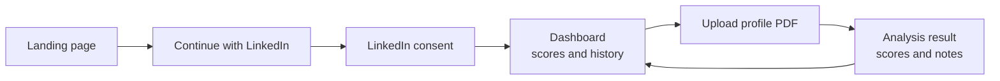
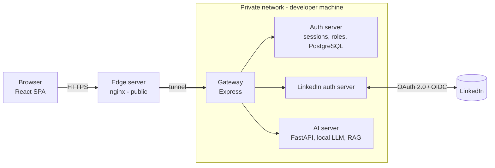

# Profile Rater — Overview

> Profile Rater is a web app where a user signs in with **LinkedIn**, uploads their **LinkedIn profile as a PDF**, and receives a **score out of 100 per profile section** plus **actionable notes**, while tracking progress against their previous check.

## What the user gets

- **Sign in / sign up with LinkedIn only.** The account is created automatically on first login.
- **Upload a profile PDF** (max 15 MB) and get an analysis.
- **Seven section scores** (0–100): Headline, About, Experience, Skills, Education, Network, Activity.
- **An overall score** with the change since the last check (example: 69, up 7 from 62).
- **"Work on these first"**: the lowest-scoring sections.
- **Detailed notes** as nested feedback, for example under Skills → Programming → React: *"it is better to specify experience"*.

## The user journey



## System at a glance



## Components

| Component            | Folder                         | Role                                                                             | Doc                                             |
| -------------------- | ------------------------------ | -------------------------------------------------------------------------------- | ----------------------------------------------- |
| Frontend             | `frontend/`                    | React SPA: login, dashboard, upload                                              | [Frontend](frontend.md)                         |
| Edge server          | `Backend/edge server`          | Public nginx that exposes the local app to the internet                          | [Edge server](edge-server.md)                   |
| Gateway              | `Backend/gateway`              | Single entry point; orchestrates the private servers                             | [Gateway](gateway.md)                           |
| Auth server          | `Backend/auth server`          | Sessions/tokens, roles and authorities, stores LinkedIn OpenID data (PostgreSQL) | [Auth server](auth-server.md)                   |
| LinkedIn auth server | `Backend/LinkedIn-auth-server` | Sign-in/up flow with LinkedIn, state verification and validation                 | [LinkedIn auth server](linkedin-auth-server.md) |
| AI server            | `Backend/ai server`            | FastAPI + local LLM + RAG; PDF in, scores and notes out                          | [AI server](ai-server.md)                       |

## Tech stack

| Layer                        | Technology                                 |
| ---------------------------- | ------------------------------------------ |
| Frontend                     | React, TypeScript, Vite, ESLint            |
| Gateway, Auth, LinkedIn auth | Node.js, Express                           |
| AI                           | Python, FastAPI, local LLM, RAG            |
| Data                         | PostgreSQL (plus Redis)                    |
| Edge                         | nginx plus a tunnel to localhost           |
| Identity                     | LinkedIn OAuth 2.0 authorization-code flow |

## Repository layout

```text
.
├── Backend/
│   ├── ai server/
│   ├── auth server/
│   ├── edge server/
│   ├── gateway/
│   └── LinkedIn-auth-server/
├── docs/                 <- you are here
├── frontend/             <- Vite + React + TypeScript
├── plan.md
└── Readme.md
```

---

## Frontend–Gateway routes

The Vite proxy forwards these frontend requests to the gateway.

### `GET /api/signin`

**Request**

Top-level browser `GET`; no request body.

**Response**

`302` redirect to LinkedIn:

```text
https://www.linkedin.com/oauth/v2/authorization?response_type=code&client_id={your_client_id}&redirect_uri={your_callback_url}&state=foobar&scope=liteprofile%20emailaddress%20w_member_social
```

Authorization query parameters:

- `response_type` — string, required. Always `code`.
- `client_id` — string, required. The API key generated for the registered LinkedIn application.
- `redirect_uri` — URL, required. Must exactly match a Redirect URL registered in the [LinkedIn application configuration](https://www.linkedin.com/developers/). The callback is handled by the proxy at `https://<edge-domain>/api/signin/callback`.
- `state` — string, optional in LinkedIn's parameter definition. A unique, hard-to-guess value is used to prevent [CSRF](https://en.wikipedia.org/wiki/Cross-site_request_forgery). `foobar` is a sample only; generate a new value for each sign-in.
- `scope` — string, required. URL-encoded, space-delimited member permissions explicitly enabled for the application: `liteprofile emailaddress w_member_social`. See [LinkedIn permissions](https://learn.microsoft.com/en-us/linkedin/shared/authentication/authentication) and [application development best practices](https://learn.microsoft.com/en-us/linkedin/shared/api-guide/best-practices/application-development?context=linkedin/context).

### `GET /api/signin/callback`

**Request**

The proxy receives LinkedIn's redirect to the registered callback URL and forwards it to the backend with `state` and either `code` or an authorization error. Successful callback example (the authorization code is a placeholder):

```text
https://<edge-domain>/api/signin/callback?state=foobar&code={authorization_code}
```

**Response**

On success, the backend sets the session cookie and redirects the browser to `/`. If sign-in fails, the backend redirects to `/auth`.

### `GET /api/me`

**Request**

Session cookie; no request body.

**Response**

`200 OK` with the current user as JSON:

```json
{
  "id": "user-123",
  "name": "Ada Lovelace",
  "given_name": "Ada",
  "email": "ada@example.com",
  "role": "user"
}
```

When the cookie is missing or invalid, the response redirects to `/auth`.

### `POST /api/signout`

**Request**

Session cookie and JSON body `{}`.

**Response**

Any `2xx` status after the session is invalidated and the cookie is cleared. The frontend ignores the response body.

### `POST /api/analyze`

**Request**

Session cookie and `multipart/form-data` with one `file` field containing the profile PDF.

**Response**

`200 OK` with JSON containing `analysisResult` and `graphData`. `analysisResult` is a JSON value containing the analysis feedback. `graphData` is keyed by metric; each metric has a numeric `val`, an optional numeric `oldval`, and an optional display `name`. `oldval` may be undefined for a user's first check.

```json
{
  "analysisResult": {
    "Summary": "A concise profile assessment.",
    "Recommendations": ["Clarify the headline."]
  },
  "graphData": {
    "headline": { "name": "Headline", "val": 82, "oldval": 74 },
    "experience": { "name": "Experience", "val": 68 }
  }
}
```

---

## Gateway routes

### Gateway → Auth server

Routes:

- `/postuser`
- `/patchuser`
- `/getuser`
- `/deleteuser`

One schema is used in the request/response body — the `user`:

```text
user {
  id
  name
  given_name
  family_name
  email
  role
}
```

### Gateway → LinkedIn auth server

The gateway is the issuer, and its base path is `/api`.

**`/api/authflow`**

- Request: empty
- Response:

```text
{
  response_type: string
  client_id:     string
  redirect_uri:  url
  state:         string
  scope:         string
}
```

**`/api/callback`**

- Request:

```text
{
  code:  string
  state: string
}
```

**`/postuser`**

- Request: `postuser`
- Response: `200`

**`/api/check-token`**

- Request: empty
- Response: success

### Gateway → AI server

**`/api/get-analysis-result`**

- Request: empty
- Response: the analysis result (same body as in `POST /api/analyze` above)

---

## Notes

- Every HTTP request goes through a full user-session authentication step: whenever the gateway receives a request, it calls `/api/me` on the auth server and expects a `200`.
- If the auth server returns `401`, the gateway pushes two things automatically:
  1. one back to the calling service, to break the function;
  2. one to the frontend, to trigger a redirect.