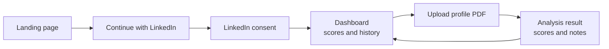
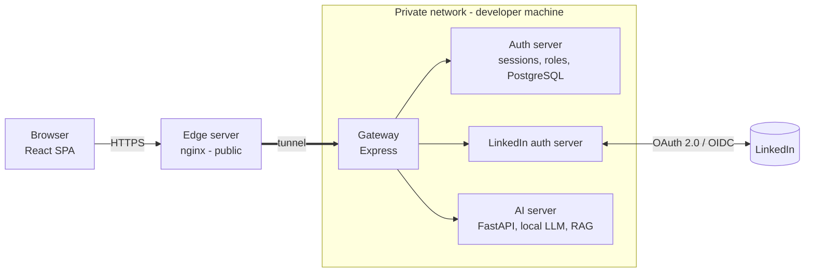

# Profile Rater — Overview

One-line summary

> Profile Rater is a web app where a user signs in with **LinkedIn**, uploads their **LinkedIn profile as a PDF**, and receives a **score out of 100 per profile section** plus **actionable notes**, while tracking progress against their previous check.

## What the user gets

- **Sign in / sign up with LinkedIn only.** The account is created automatically on first login.
- **Upload a profile PDF** (max 15 MB) and get an analysis.
- **Seven section scores** (0–100): Headline, About, Experience, Skills, Education, Network, Activity.
- **An overall score** with the change since the last check (example: 69, up 7 from 62).
- **"Work on these first"**: the lowest-scoring sections.
- **Detailed notes** as nested feedback, for example under Skills → Programming → React: _"it is better to specify experience"_.

## The user journey



## System at a glance




## Components

| Component            | Folder                         | Role                                                                             | Doc                                             |
| -------------------- | ------------------------------ | -------------------------------------------------------------------------------- | ----------------------------------------------- |
| Frontend             | `frontend/`                    | React SPA: login, dashboard, upload                                              | [Frontend](frontend.md)                         |
| Edge server          | `Backend/edge server`          | Public nginx that exposes the local app to the internet                          | [Edge server](edge-server.md)                   |
| Gateway              | `Backend/gateway`              | Single entry point; orchestrates the private servers                             | [Gateway](gateway.md)                           |
| Auth server          | `Backend/auth server`          | Sessions/tokens, roles and authorities, stores LinkedIn OpenID data (PostgreSQL) | [Auth server](auth-server.md)                   |
| LinkedIn auth server | `Backend/LinkedIn-auth-server` | Sign-in/up flow with LinkedIn, state verification and validation                 | [LinkedIn auth server](linkedin-auth-server.md) |
| AI server            | `Backend/ai server`            | FastAPI + local LLM + RAG; PDF in, scores and notes out                          | [AI server](ai-server.md)                       |

## Tech stack

| Layer                        | Technology                                         |
| ---------------------------- | -------------------------------------------------- |
| Frontend                     | React, TypeScript, Vite, ESLint                    |
| Gateway, Auth, LinkedIn auth | Node.js, Express                                   |
| AI                           | Python, FastAPI, local LLM, RAG                    |
| Data                         | PostgreSQL (plus redis) |
| Edge                         | nginx plus a tunnel to localhost                   |
| Identity                     | LinkedIn OAuth 2.0 authorization-code flow                        |

## Repository layout

```
.
├── Backend/
│   ├── ai server/
│   ├── auth server/
│   ├── edge server/
│   ├── gateway/
│   └── LinkedIn-auth-server/
├── docs/                 <- you are here
├── frontend/             <- Vite + React + TypeScript
├── plan.md
└── Readme.md
```

## Frontend–Gateway API contracts

This is the canonical contract for requests from the browser frontend to the
gateway. The service documents describe internal responsibilities and
implementation; they do not define a separate frontend-facing API. These
contracts describe the intended integration and do not imply that every route
is implemented yet.

All paths below are same-origin paths under `/api`. The edge/proxy must forward
these paths to the gateway, including the LinkedIn callback. Browser requests
that need the session send the session cookie. The cookie is `HttpOnly`,
`Secure` in production, and uses an appropriate `SameSite` policy.

### Authentication

| Method and path | Request | Success / behavior |
|---|---|---|
| `GET /api/signin` | Top-level browser navigation; no request body. | Redirects (`302`) to LinkedIn's authorization endpoint using the parameters below. |
| `GET /api/signin/callback` | LinkedIn redirects the browser here with `code` and `state`; the public proxy forwards the request to the backend auth flow. | Backend validates the response, exchanges the code server-to-server, establishes a session, then sets the session cookie and redirects to `/`. On failure, it redirects to `/auth?error=<safe-code>`. |
| `GET /api/me` | Sends the session cookie; no request body. | With a valid session, returns the current user as JSON. With a missing or invalid session, redirects to `/auth`. |
| `POST /api/signout` | Sends the session cookie and an empty JSON object (`{}`). | Invalidates the session, clears the cookie, and returns a successful status. Sign-out should be idempotent. |

Example `/api/me` success response:

```json
{
  "id": "user-123",
  "name": "Ada Lovelace",
  "given_name": "Ada",
  "email": "ada@example.com",
  "role": "user"
}
```

The frontend uses these fields to display the signed-in user. Visibility of
role-specific UI is not a substitute for backend authorization.

The `GET /api/signin` redirect uses this URL shape:

```text
https://www.linkedin.com/oauth/v2/authorization
  ?response_type=code
  &client_id={your_client_id}
  &redirect_uri={your_callback_url}
  &state={unique_random_state}
  &scope=liteprofile%20emailaddress%20w_member_social
```

`your_client_id` and `your_callback_url` are application configuration values.
Generate a fresh, hard-to-guess `state` for each login and bind it to the
browser; `foobar` is only an example and must not be used as a constant. The
callback URL must be registered with LinkedIn and match the public proxied
callback exactly. Keep client secrets and exchanged tokens on the backend.

> [!important]
> The frontend currently checks the session using `fetch`. Fetch follows HTTP
> redirects automatically, so the frontend recognizes the redirected `/auth`
> response as an unauthenticated session and navigates there instead of
> treating the login page as user data.

The supported public login error codes are `access_denied`, `login_failed`,
and `session_expired`. Do not include secrets, authorization codes, tokens, or
raw internal errors in redirect URLs.

### Profile metrics and analysis

| Method and path | Request | Success response |
|---|---|---|
| `GET /api/graph` | Sends the session cookie; no request body. | JSON object keyed by metric. An empty object means the user has no scores yet. |
| `POST /api/analyze` | Sends the session cookie and `multipart/form-data` with one `file` field containing the profile PDF. | JSON object containing both `analysisResult` and `graphData`. |

The browser checks that the file is a PDF and no larger than 15 MiB before
uploading. The backend must repeat file type, content, and size validation.
`analysisResult` may be any JSON value (including nested objects and arrays)
and contains the feedback displayed by the frontend. `graphData` is the latest
score snapshot and uses the same shape as `/api/graph`, so the frontend does
not make a second graph request after a successful analysis.

Example graph response:

```json
{
  "headline": { "name": "Headline", "val": 82, "oldval": 74 },
  "experience": { "name": "Experience", "val": 68 },
  "skills": { "name": "Skills", "oldval": 55 }
}
```

Each metric may include a display `name` and current `val` and/or previous
`oldval`. Any supplied score must be a finite number; at least one score is
required for a metric to render. Names are optional in analysis responses; the
frontend falls back to the metric key.

Example analysis response:

```json
{
  "analysisResult": {
    "Summary": "A concise profile assessment.",
    "Recommendations": ["Clarify the headline.", "Add measurable outcomes."]
  },
  "graphData": {
    "headline": { "name": "Headline", "val": 82, "oldval": 74 },
    "experience": { "name": "Experience", "val": 68 }
  }
}
```

For JSON API failures, return a non-2xx status and a safe message, for example
`{ "message": "A user-safe explanation" }`. Do not return stack traces,
secrets, or tokens. The frontend displays safe error messages and does not
automatically retry mutations.

These are the only frontend–gateway contracts documented here. The current
frontend still contains an admin magic-link form and legacy service helpers;
they are not part of this contract and need separate product/implementation
decisions before being exposed as gateway routes.


