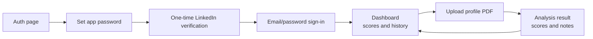
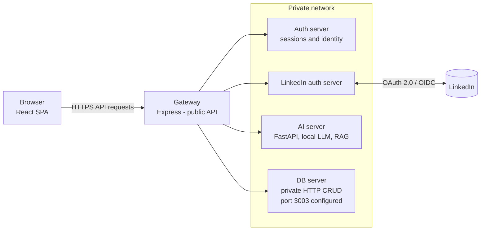

# Profile Rater — Overview

> Profile Rater is a web app where a user signs up once with **LinkedIn**, then signs in with their **email and app password**, uploads their **LinkedIn profile as a PDF**, and receives a **score out of 100 per profile section** plus **actionable notes**.

## What the user gets

- **One-time sign-up with LinkedIn.** Returning users sign in with their verified LinkedIn email and app password.
- **Upload a profile PDF** (max 15 MB) and get an analysis.
- **Seven section scores** (0–100): Headline, About, Experience, Skills, Education, Network, Activity.
- **An overall score** with the change since the last check (example: 69, up 7 from 62).
- **"Work on these first"**: the lowest-scoring sections.
- **Detailed notes** as nested feedback, for example under Skills → Programming → React: *"it is better to specify experience"*.

## The user journey



## System at a glance



## Components

| Component            | Folder                         | Role                                                                             | Doc                                             |
| -------------------- | ------------------------------ | -------------------------------------------------------------------------------- | ----------------------------------------------- |
| Frontend             | `frontend/`                    | React SPA: login, dashboard, upload                                              | [Frontend](frontend.md)                         |
| Gateway              | `Backend/gateway`              | Single entry point; orchestrates the private servers                             | [Gateway](gateway.md)                           |
| Auth server          | `Backend/auth server`          | Session lifecycle and authenticated identity (`/api/me`)                        | [Auth server](auth-server.md)                   |
| LinkedIn auth server | `Backend/LinkedIn-auth-server` | Sign-in/up flow with LinkedIn, state verification and validation                 | [LinkedIn auth server](linkedin-auth-server.md) |
| AI server            | `Backend/ai server`            | FastAPI + local LLM + RAG; PDF in, scores and notes out                          | [AI server](ai-server.md)                       |
| DB server            | `Backend/db server`            | Planned private HTTP service for `User` and `Analysis` persistence and CRUD      | [DB server](database-server.md)                 |

## Tech stack

| Layer                        | Technology                                 |
| ---------------------------- | ------------------------------------------ |
| Frontend                     | React, TypeScript, Vite, ESLint            |
| Gateway, Auth, LinkedIn auth | Node.js, Express                           |
| AI                           | Python, FastAPI, local LLM, RAG            |
| Database API                 | Separate HTTP service; port 3003 configured; implementation pending |
| Data                         | `User` and `Analysis` entities; storage engine TBD |
| Identity                     | LinkedIn OAuth 2.0 authorization-code flow |

## Repository layout

```text
.
├── Backend/
│   ├── ai server/
│   ├── auth server/
│   ├── db server/       <- planned separate process; port 3003 configured
│   ├── edge server/     <- legacy; no longer required
│   ├── gateway/
│   └── LinkedIn-auth-server/
├── docs/                 <- you are here
├── frontend/             <- Vite + React + TypeScript
├── plan.md
└── Readme.md
```

---

## Frontend–Gateway routes

The Vite proxy forwards these frontend requests to the gateway.

### `POST /api/signup`

**Request**

JSON with the app password chosen before LinkedIn verification:

```json
{ "password": "user-chosen-password" }
```

The gateway keeps the password out of the OAuth URL. The auth server stores
only a password hash in Redis, bound to the short-lived OAuth state.

**Response**

`200 OK` with the LinkedIn authorization URL:

```json
{ "authorizationUrl": "https://www.linkedin.com/oauth/v2/authorization?..." }
```

### `GET /api/signin/callback`

**Request**

The proxy receives LinkedIn's redirect to the registered callback URL and forwards it to the backend with `state` and either `code` or an authorization error. Successful callback example (the authorization code is a placeholder):

```text
https://<edge-domain>/api/signin/callback?state=foobar&code={authorization_code}
```

**Response**

On successful verification, the auth server creates the local user and session,
sets an HttpOnly session cookie, and redirects the browser to `/`. Failures
redirect to `/auth?error=<safe-code>`.

### `POST /api/signin`

**Request**

```json
{ "email": "ada@example.com", "password": "user-chosen-password" }
```

**Response**

`204 No Content` and an HttpOnly session cookie. Unknown emails and incorrect
passwords both return `401` with the same safe error message.

### `GET /api/me`

**Request**

Session cookie; no request body.

**Response**

`200 OK` with the display name and minimal role used by the existing
admin-only UI. The user ID and credential data are never returned:

```json
{
  "displayName": "Ada Lovelace",
  "role": "unpaid"
}
```

The auth server validates the cookie-backed Redis session and revalidates the
account against the DB at most once per 24 hours. If account data changed, the
session cache is refreshed without ending the active session. A missing or
invalid cookie returns `401`.

### `POST /api/signout`

**Request**

Session cookie and JSON body `{}`.

**Response**

`204 No Content` after the session is invalidated and the cookie is cleared.
Failures are surfaced rather than reported as a successful sign-out.

### `POST /api/analyze`

**Request**

Requires the session cookie established by sign-in. Send the profile PDF as
`multipart/form-data` in a single field named `file`:

```text
POST /api/analyze
Content-Type: multipart/form-data

file: <profile PDF>
```

The frontend rejects files that are not reported as `application/pdf` or are
larger than 15 MiB before uploading. The server must validate the upload
independently.

**Successful response**

`200 OK` with the analysis feedback as plain text
(`Content-Type: text/plain`). The response has no JSON envelope, score data,
or graph data.

The gateway receives the structured result from the internal AI service,
persists the feedback and scores as an `Analysis` record owned by the
authenticated user from the private `/authorize` response, then returns only the feedback text to the
browser. The internal score fields are listed in [[database-server]]. The
frontend then requests `GET /api/analyses?limit=10` to refresh score history.

**Failure behavior**

- `401` when the request has no valid session.
- `403` when the request is forbidden. The frontend redirects to `/auth` on
  authorization failures.
- `415` when the request is not a multipart upload.
- `502` when a required downstream service fails or returns an invalid result.

### `GET /api/analyses`

**Request**

Session cookie; no request body. Optional query parameter `limit`: integer
from 1 to 10; defaults to 10. The frontend requests the latest 10 records.

```text
GET /api/analyses?limit=10
```

**Response**

`200 OK` with an array of the authenticated user's analysis records, newest
first. Each record includes `id`, `user_id`, `created_at`, and the eight
numeric scores documented in [[database-server]]. The current analysis is
included as the first record after a successful analysis.

```json
[
  {
    "id": "analysis-123",
    "user_id": "user-123",
    "full_name":"yahya ben yahya",
    "created_at": "2026-11-16T08:30:00Z",
    "completeness": 82,
    "content_quality": 68,
    "keyword_and_role_relevance": 75,
    "career_trajectory": 70,
    "skills_depth": 80,
    "social_proof": 64,
    "network": 55,
    "activity": 72
  }
]
```

The frontend displays the newest record as **Current**. For each metric, it
calculates one **Older average** bar from the remaining returned records,
excluding the current record. With only one record, no older-average bar is
shown. The overall older rating is calculated from those per-metric averages.

---

## Gateway routes

### Gateway → Auth server

The gateway uses the auth server's internal `/authorize` route to validate
protected requests and obtain the authenticated ID and role. Public
`GET /api/me` returns only display name and minimal role to the frontend.
`POST /signin` verifies local email/password credentials; one-time LinkedIn
registration stores a pending password hash, then the auth server creates the
user through the private DB API and issues the Redis session. All internal
auth requests require `AUTH_INTERNAL_TOKEN`.


### Gateway → DB server

The gateway calls the DB server directly over its private HTTP interface for
`Analysis` CRUD. The auth server also calls it for credential user lookup and
one-time account creation. The DB server runs as a separate process on its own
port (`3003`, configured in shared config); implementation is owned by another
branch.
It is not a browser-facing API and must not be exposed through Vite or the
public edge proxy.

The planned internal endpoints use `GET`, `POST`, `PATCH`, and `DELETE`; no
`PUT` endpoint is defined. The full request/response contracts, entity fields,
authorization rules, and implementation gaps are in
[[database-server]]. In particular, the gateway must pass trusted actor
identity (`id` and `role`) for updates, and the DB server must enforce the
rules independently.

The gateway's analysis endpoints use the DB server's internal
`POST /internal/v1/analyses` to persist each scored result and
`GET /internal/v1/analyses?limit=N` to retrieve a bounded history for the
authenticated user.

### Gateway → LinkedIn auth server

The gateway delegates authorization-code handling and identity verification
to the LinkedIn auth server. The full sequence is in
[[LinkedIn-auth-flow]].

**`/api/authflow`**

- Request: empty
- Response:

```text
{
  response_type: string
  client_id:     string
  redirect_uri:  url
  state:         string
  scope:         string
}
```

**`/api/callback`**

- Request:

```text
{
  code:  string
  state: string
}
```

After identity verification, the gateway finds or creates the user through
the DB server. The LinkedIn auth server does not own user-record CRUD.

**`/api/check-token`**

- Request: empty
- Response: success

### Gateway → AI server

**`POST /api/analyze`**

- Request: gateway forwards the authenticated user's PDF as multipart data.
- Internal response: JSON with `analysis_result` as text and the eight score
  fields in [[database-server]]. The gateway validates and persists this
  record for the authenticated `user_id`.
- Browser response: the feedback text only (`text/plain`); no JSON envelope
  or score data is returned by this route.

 

## Notes

- Protected browser API requests enter through the gateway. Before handling
  them, the gateway validates the session with the auth server's private `/authorize`
  endpoint. A failed check prevents the protected operation.
- For DB mutations, the gateway passes the authenticated actor's `id` and
  `role`; it must derive these from `/authorize`, not from browser-supplied data.
  The DB server independently validates authorization and field-level rules.
- The DB server's storage engine and implementation are not yet set.
  See [[database-server]] for the proposed contract and outstanding schema
  decisions.